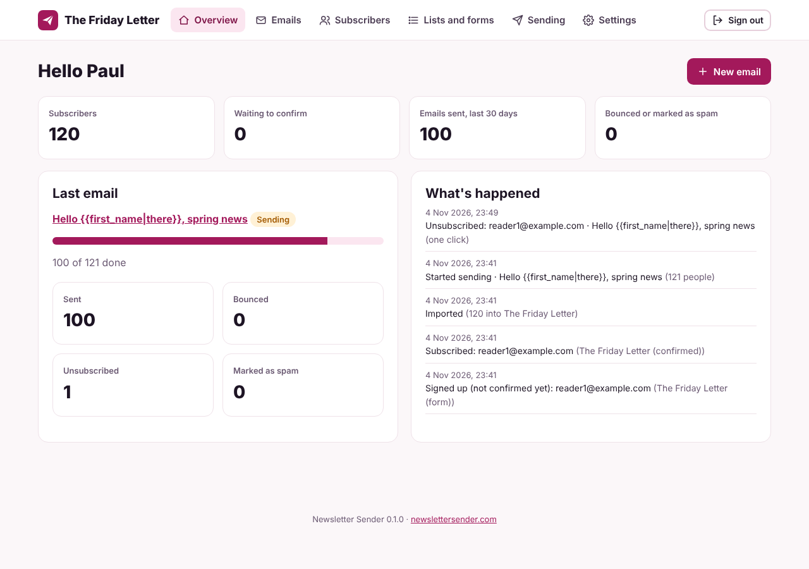
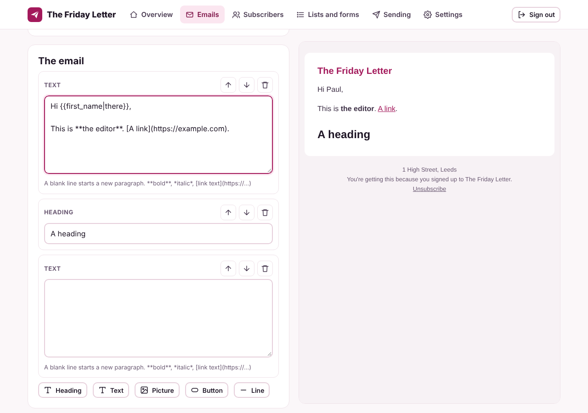
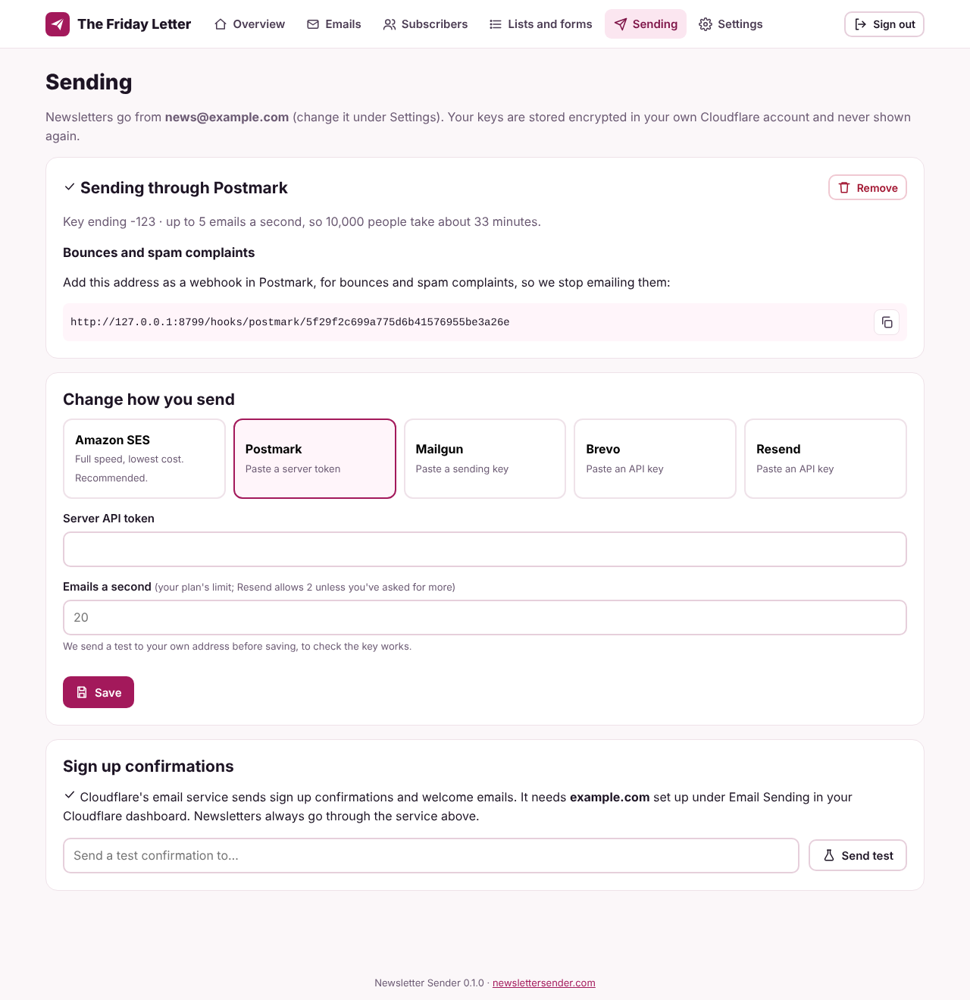
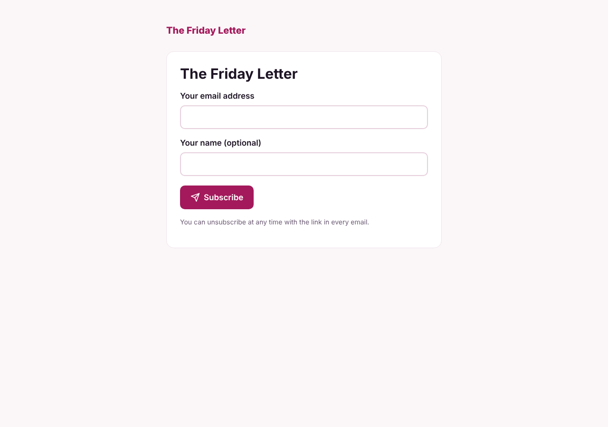

<div align="center">
  <h1>Newsletter Sender</h1>
  <p><strong>Newsletter sending you own. Runs in your own Cloudflare account, sends through Amazon SES.</strong><br>
  Lists, sign up forms, an email editor, imports from your old tool, bounces and stats.</p>
  <p><a href="https://newslettersender.com/">Website</a> · <a href="#install">Install</a> · <a href="https://github.com/pobren/newsletter-sender/issues">Report a bug</a></p>
</div>

Newsletter Sender runs in your own Cloudflare account. Your subscribers, your emails and your stats stay there, and you send through your own Amazon SES account (or Postmark, Mailgun, Brevo, Resend, SendGrid, SparkPost or any SMTP server), so you pay their sending price and nothing per subscriber.

**Free for your own newsletters, source available.** See [Licence](#licence) below.



## What it does

- **Lists and sign up forms.** A hosted sign up page for each list, and a form to paste into your own website. Extra questions if you want them, and a robot check if you switch on Turnstile.
- **Double opt in.** New readers confirm by email first (you can turn it off per list). The confirm link is safe from email scanners that click every link.
- **The editor.** Write in the visual editor (paste straight from Word or Google Docs), switch to HTML whenever you like, or upload a whole designed email. Pictures go to your own storage. `{{first_name|there}}` puts in each reader's first name, and a design can place its own unsubscribe link with `{{unsubscribe_url}}`.
- **As many lists as you like.** A main list, a test list, one per brand or topic. Choose whether someone can be on more than one, whether unsubscribing leaves every list or just that one, and which lists each form adds people to.
- **Sending at full speed.** Newsletter Sender reads your SES sending rate and spreads the sending across up to ten workers, so a 10,000 person list at 14 a second takes about 12 minutes. If the service says slow down, it does, and carries on.
- **Safety checks.** It won't send from an SES sandbox account, or more than your daily SES limit. If every email in a batch is turned down the same way (an unverified domain, a revoked key), sending pauses and tells you why.
- **Test, schedule, stop.** Send a test to yourself, schedule it for later, or stop a send part way.
- **Unsubscribe in one click.** Every email has an unsubscribe link and the one click unsubscribe headers Gmail and Yahoo ask bulk senders for.
- **Bounces and spam complaints.** Hard bounces and complaints come straight back and that address is never emailed again.
- **Import and export.** CSV files from Mailchimp, Sendy, Substack, Kit and others. We find the email column, join first and last names and keep extra columns. Nobody who unsubscribed, bounced or complained is added back.
- **Reports.** Sent, bounced, unsubscribed and marked as spam for every email, and every bounce and complaint. Opens and clicks are **off by default**: switch each on in Settings, with your own tracking address if you like.
- **Public archive.** Past issues on the web at `/archive`, if you want it.



## What you need

- A Cloudflare account on the Workers Paid plan ($5 a month). The free plan limits each run to a few milliseconds of work and 50 outside requests, which isn't enough to send a batch of emails.
- A domain to send from, such as `news@yourdomain.com`.
- An [Amazon SES](https://aws.amazon.com/ses/) account (recommended), or Postmark, Mailgun, Brevo, Resend, SendGrid, SparkPost or any SMTP server.

## Install

```sh
git clone https://github.com/pobren/newsletter-sender.git
cd newsletter-sender
npm install
npx wrangler queues create newsletter-sender-sends
npx wrangler secret put SETUP_TOKEN    # a long secret code you make up
npm run deploy
```

Wrangler, Cloudflare's own tool, asks you to sign in to Cloudflare in your browser. It makes the database and the picture storage on the first deploy, and Newsletter Sender makes its own tables the first time it runs.

Then open `https://<your Newsletter Sender address>/setup?code=<your code>` to make your account. Only someone with the code can. The same link resets your password if you ever forget it.

Updating keeps everything you've set up. Go to Settings, Account: when a new version is out you'll see what's new and an Update button, and Go back puts the old version straight back if you need it. You can also pull the new version and run `npm run deploy` again.

To try it on your computer first: copy `.dev.vars.example` to `.dev.vars`, choose a code, then `npm run dev`.

## Amazon SES

The full guide, with screen grabs, is at [newslettersender.com/help/amazon-ses](https://newslettersender.com/help/amazon-ses/).

1. In Newsletter Sender, open **Settings › Sending**, choose **Amazon SES** and your region, then press **Create the user and keys in AWS**. AWS opens with [aws/newsletter-sender-ses.yaml](aws/newsletter-sender-ses.yaml) filled in: tick the box and press **Create stack**. It makes a user that can only use SES and SNS, with one access key.
2. When the stack says CREATE_COMPLETE, copy the two keys from its **Outputs** tab into Newsletter Sender and press Save.
3. Optional: if your domain is on Cloudflare, paste a Cloudflare API token that can edit its DNS, and Newsletter Sender adds the DNS records itself.
4. Press **Set up Amazon SES for me**. It adds your domain with DKIM signing, a `bounce.` subdomain for bounces, sends every bounce and complaint back to Newsletter Sender, adds the DNS records (on Cloudflare) and asks Amazon to take the account out of the sandbox.
5. Not on Cloudflare? Add the DNS records it shows (each has a copy button).
6. Press **Check where it's up to**. Amazon replies to the sandbox request by email, usually within a day.

To remove the AWS user later, delete the `newsletter-sender` stack in CloudFormation.



### Postmark, Mailgun, Brevo, Resend, SendGrid or SparkPost

Paste your key on the **Sending** tab and your plan's emails a second. We send a test to you before saving. We add the webhook for bounces and spam complaints in that service for you. If the key isn't allowed to, the tab shows the address to add yourself.

### Your own SMTP server

Enter your email host's SMTP server, port (587 or 465; Cloudflare doesn't allow 25), user name and password. We open one connection for each email, so keep the speed low unless your host allows more. Bounces come back to your from address as emails, so check that inbox after each newsletter.

## Sign up confirmations

Confirmation and welcome emails go through Cloudflare's own email service, so they're fast and don't use your newsletter sending. Set your sending domain up under **Email › Email Sending** in Cloudflare. Newsletters themselves always go through SES or the service you chose. If Cloudflare's email service isn't set up, confirmations go through that service instead.

## Robot check (optional)

Sign in, set-up and sign up forms can use [Cloudflare Turnstile](https://developers.cloudflare.com/turnstile/). In Cloudflare, add a Turnstile widget for your Newsletter Sender address (Managed), then add two secrets to the Worker: `TURNSTILE_SITE_KEY` and `TURNSTILE_SECRET`. It switches on once both are there.

## How it works

One Cloudflare Worker, a D1 database, a queue and an R2 bucket for pictures. When you press send, every reader gets a row, the rows go on the queue in batches of 50, and up to ten workers send them at their share of your sending rate. What's been sent is saved as it goes, so a worker that stops part way picks up where it left off. A check every minute starts scheduled emails.

Your sending keys are stored encrypted in your database. They're never shown again, only the last few characters.



## Licence

Newsletter Sender is source available under the [Business Source License 1.1](LICENSE). In plain English:

- **Free** for one person or organisation's own newsletters, with any number of subscribers. This free edition runs one brand.
- **Agency edition:** more brands, logins for your clients with limits you set, and every brand at a glance. It's built in: paste an agency licence key into Settings, Licence to switch it on. Once a day the app checks the licence is still active with newslettersender.com, sending only the licence number, the app version and a short fingerprint of the key (never the key itself). See [newslettersender.com/agency](https://newslettersender.com/agency/).
- **Needs a commercial licence:** sending for clients or other people, or offering it as a hosted, managed or white label service. [Get an Agency licence](https://newslettersender.com/contact/?topic=agency).
- Each version becomes Apache 2.0 four years after it's released.

The free edition has no licence key. We trust you. The [LICENSE](LICENSE) file is the legal text.

## Help

Questions and bugs go to [GitHub issues](https://github.com/pobren/newsletter-sender/issues). Please don't send personal details there.
